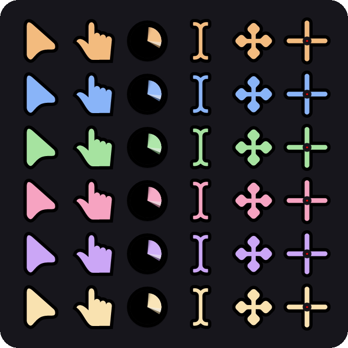

<h1 align="center">cursor-tint</h1>

<p align="center">
  the <a href="https://github.com/ful1e5/Bibata_Cursor">Bibata Modern</a> cursor in any color, rebuilt in about a second.<br>
  hook it to your wallpaper and the cursor follows the accent like everything else.
</p>

<p align="center">
  
</p>

## why

ready-made cursor themes come in black, white and maybe one orange. if your whole desktop is painted from the
wallpaper (matugen, pywal, wallust), the cursor is the one thing that never changes. `cursor-tint` takes the Bibata
sources, swaps the colors and writes a fresh XCursor theme: all 56 cursors with their aliases, the animated spinners
(54 frames), five sizes. no node, no build toolchain: python with Pillow and `resvg` or `rsvg-convert`.

## use

```sh
cursor-tint '#f3bc7e' --apply           # body in the accent, edge picked for contrast, switch to it
cursor-tint '#8ab4f8' '#0b1a33' --apply  # your own edge color
cursor-tint '#a6e3a1' --spinner '#a6e3a1,#94e2d5,#89b4fa,#f9e2af' --apply
```

`--apply` switches live in hyprland (`hyprctl setcursor`), sets gsettings for GTK and GNOME, points
`~/.local/share/icons/default` at the new theme for XWayland, and updates the systemd and D-Bus environment for apps
started later.

every color set gets its own theme name (`Tint-<hash>`): compositors and toolkits cache themes by name, so reusing one
name would leave old cursors around. older builds are cleaned up, the one in use stays.

options: `--disc` (the circle behind the spinner), `--name`, `--sizes 24,32,48`, `--size` (what `--apply` sets),
`--dir` (default `~/.local/share/icons`). run `cursor-tint --help`.

## with matugen

```toml
# ~/.config/matugen/config.toml
[templates.cursor]
input_path = "~/.config/matugen/templates/empty"
output_path = "/tmp/matugen-cursor"
post_hook = "cursor-tint '{{colors.primary.default.hex}}' '{{colors.on_primary.default.hex}}' --apply"
```

with pywal or wallust, call it from your wallpaper script with `color4` or whatever your accent is.

## install

```sh
git clone https://github.com/anaidyss/cursor-tint ~/.local/share/cursor-tint
ln -s ~/.local/share/cursor-tint/cursor-tint ~/.local/bin/
# arch: pacman -S python-pillow resvg   ·   fedora: dnf install python3-pillow librsvg2-tools
```

the script finds the SVG sources in `src/` next to itself (the symlink is resolved).

## notes

- apps already running under XWayland (Steam, some games) read the cursor at start and keep the old one until restart.
  wayland apps on the cursor-shape protocol (GTK4, Qt6, Firefox, Chromium) switch at once.
- the theme is XCursor only; hyprland falls back to it when there is no hyprcursor theme, which is fine.
- part of [hypr-shell](https://github.com/anaidyss/hypr-shell), where it runs on every wallpaper change.

## license

GPL-3.0, same as Bibata. the SVGs and `x.build.toml` in `src/` are from
[Bibata_Cursor v2.0.7](https://github.com/ful1e5/Bibata_Cursor) by Abdulkaiz Khatri.
